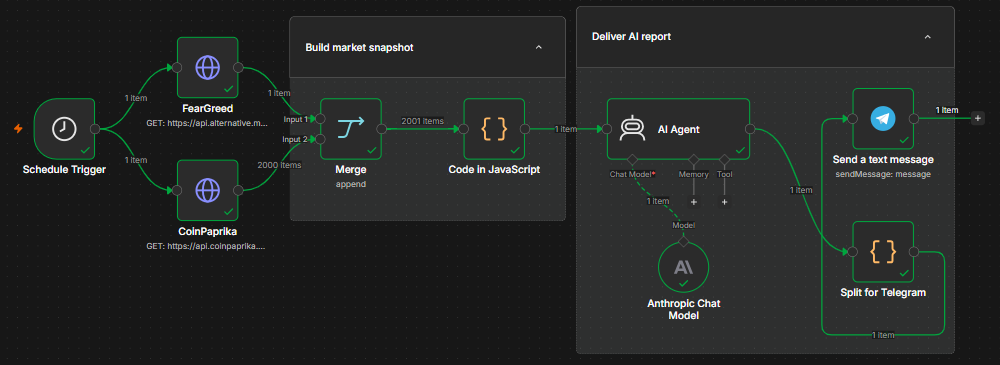

# Crypto Market AI Report (n8n)

An n8n workflow that runs every morning, pulls live crypto market data from two public APIs, turns it into a compact market snapshot with JavaScript, asks an AI agent (Claude, via the Anthropic Chat Model node) for a short analysis, and posts the report to a Telegram channel.

## What it does

1. **Schedule Trigger** starts the workflow every day at 07:00.
2. **Two HTTP requests run in parallel:**
   - **FearGreed** gets the Crypto Fear & Greed Index for the last 7 days from `api.alternative.me/fng/`.
   - **CoinPaprika** gets prices, market caps, volumes and % changes for ~2,000 coins from `api.coinpaprika.com/v1/tickers`.
3. **Merge** combines both responses into one stream (~2,000 items).
4. **Code in JavaScript** builds the market snapshot:
   - filters out illiquid coins (market cap below $50M or 24h volume below $1M), stablecoins and wrapped/staked duplicates of BTC and ETH;
   - calculates a simple, explainable **risk score** (0–100) and a **momentum score** for each coin, compared with BTC;
   - measures market breadth and sentiment, and flags stablecoins that lose their $1 peg;
   - produces a short Markdown message for the agent (top coins by market cap, leaders and laggards, volume spikes, candidates and red flags) plus a structured JSON summary.
5. **AI Agent** with **Anthropic Chat Model** reads the snapshot and writes a short report: what to watch, the main risks and possible opportunities. The system prompt tells it to rely only on the provided data and to state that the analysis is not financial advice.
6. **Split for Telegram** splits the report into chunks under Telegram's 4,096-character limit, keeping line breaks intact.
7. **Send a text message** posts each chunk to the Telegram channel.

## Tech

n8n · REST APIs · JSON · JavaScript · AI Agent (LangChain nodes) · Anthropic Claude · Telegram Bot API

## How to use it

1. In n8n, go to **Workflows → Import from File** and select `Crypto Market AI Report.json`.
2. Add your credentials (they are not included in the export):
   - **Anthropic API** key for the *Anthropic Chat Model* node;
   - **Telegram API** bot token for the *Send a text message* node.
3. In *Send a text message*, set **Chat ID** to your own channel or chat (for a channel, add the bot as an admin).
4. Adjust the schedule in *Schedule Trigger* and the filters in the `CONFIG` object at the top of the *Code in JavaScript* node if needed.
5. Click **Execute workflow** to test it, then publish it.

Both market data APIs are public and need no API key.

## Disclaimer

This project is for learning and demonstration purposes. The generated reports are not financial advice.
